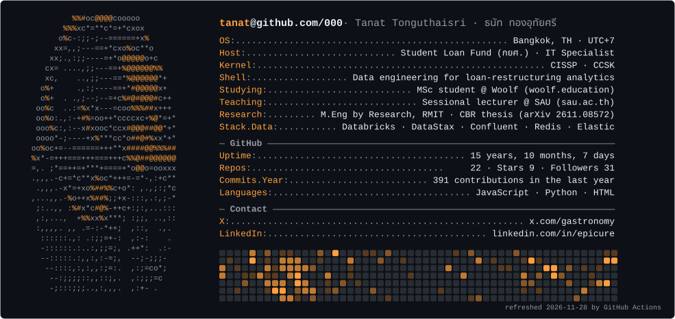
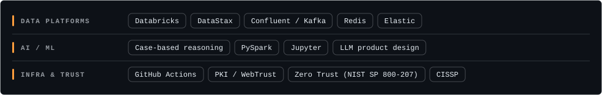
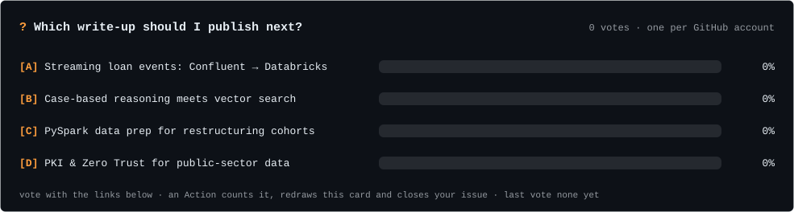

<!-- Generated in part by scripts/build_readme.py. Edit config/profile.json, not the marked blocks. -->
<picture>
  <source media="(prefers-color-scheme: dark)" srcset="./assets/hero-dark.svg">
  <source media="(prefers-color-scheme: light)" srcset="./assets/hero-light.svg">
  
</picture>

<!-- positioning:start -->

<b>Data engineering for loan-restructuring analytics at Thailand's Student Loan Fund (กยศ.): lakehouse, streaming and search, shaped by case-based reasoning research since 2003.</b>

<!-- positioning:end -->

<picture>
  <source media="(prefers-color-scheme: dark)" srcset="./assets/stack-dark.svg">
  <source media="(prefers-color-scheme: light)" srcset="./assets/stack-light.svg">
  
</picture>

### Featured work

<!-- featured:start -->

<!-- featured:end -->

<table>
<tr>
<td valign="top" width="33%">

#### Recently shipped
<!-- shipped:start -->
- [udacity-nd088-llm-product-proposal](https://github.com/000/udacity-nd088-llm-product-proposal) 2026-11-16
- [background-samplers](https://github.com/000/background-samplers) 2026-11-03
- [000.github.io](https://github.com/000/000.github.io) 2026-10-26
- [clawd](https://github.com/000/clawd) 2026-09-22
- [PDF](https://github.com/000/PDF) 2026-03-25
<!-- shipped:end -->

</td>
<td valign="top" width="33%">

#### Releases
<!-- releases:start -->
- No tagged releases yet. Tag one and it appears here on the next daily run.
<!-- releases:end -->

</td>
<td valign="top" width="34%">

#### Research
<!-- papers:start -->
- [Enhancing Academic Advisement with Case-Based Reasoning](https://arxiv.org/abs/2611.08572) arXiv:2611.08572 [cs.AI, cs.CY] · submitted 5 Nov 2026 · proofread edition of the Aug 2003 RMIT M.Eng thesis
- [Enhancing Academic Advisement with Case-Based Reasoning](https://zenodo.org/records/23936099) Zenodo record 23936099 · thesis, publication date 1 Aug 2003
- [SSRN thesis listing (abstract 7696240)](https://papers.ssrn.com/sol3/papers.cfm?abstract_id=7696240) title not shown: the SSRN page could not be fetched on 23 Nov 2026
<!-- papers:end -->

</td>
</tr>
</table>

### Ask the audience

<picture>
  <source media="(prefers-color-scheme: dark)" srcset="./assets/poll-dark.svg">
  <source media="(prefers-color-scheme: light)" srcset="./assets/poll-light.svg">
  
</picture>

<!-- poll:start -->

Vote: <a href="https://github.com/000/000/issues/new?title=poll%3A%20A&amp;body=Just%20press%20%2A%2ASubmit%20new%20issue%2A%2A.%20A%20GitHub%20Action%20counts%20your%20vote%2C%20redraws%20the%20poll%20and%20closes%20this%20issue."><b>A</b> Streaming loan events: Confluent → Databricks</a> · <a href="https://github.com/000/000/issues/new?title=poll%3A%20B&amp;body=Just%20press%20%2A%2ASubmit%20new%20issue%2A%2A.%20A%20GitHub%20Action%20counts%20your%20vote%2C%20redraws%20the%20poll%20and%20closes%20this%20issue."><b>B</b> Case-based reasoning meets vector search</a> · <a href="https://github.com/000/000/issues/new?title=poll%3A%20C&amp;body=Just%20press%20%2A%2ASubmit%20new%20issue%2A%2A.%20A%20GitHub%20Action%20counts%20your%20vote%2C%20redraws%20the%20poll%20and%20closes%20this%20issue."><b>C</b> PySpark data prep for restructuring cohorts</a> · <a href="https://github.com/000/000/issues/new?title=poll%3A%20D&amp;body=Just%20press%20%2A%2ASubmit%20new%20issue%2A%2A.%20A%20GitHub%20Action%20counts%20your%20vote%2C%20redraws%20the%20poll%20and%20closes%20this%20issue."><b>D</b> PKI &amp; Zero Trust for public-sector data</a>

<!-- poll:end -->

<picture>
  <source media="(prefers-color-scheme: dark)" srcset="https://raw.githubusercontent.com/000/000/output/snake-dark.svg">
  <source media="(prefers-color-scheme: light)" srcset="https://raw.githubusercontent.com/000/000/output/snake-light.svg">
  
</picture>

Every graphic here is an SVG built from GitHub's API by a daily Action using only the repo's own GITHUB_TOKEN. No third-party stats servers.

